<div align="center">

# AIMScribe v3

**Secure clinical audio capture, joined to the prescription of the same visit.**

[](https://github.com/SakibZaman021/AIMScribe_v3/actions/workflows/tests.yml)


[Architecture](#4-high-level-architecture) ·
[Recorder ↔ server](#7-how-aimscribeexe-communicates-with-the-server) ·
[Data flows](#9-data-flow-diagrams) ·
[Databases](#10-database-dbms-architecture) ·
[ER diagrams](#11-entityrelationship-diagrams) ·
[Security](#13-security-architecture)

</div>

AIMScribe records doctor–patient consultations in clinics running CMED's EHR, verifies
every second of audio with a device-signed hash chain, and links each recording to the
patient information and prescription CMED sends for the same `visit_id` — producing
research datasets of *audio + structured prescription* with a provable chain of custody.

| | |
|---|---|
| 🎙️ **Never loses audio** | Records offline into an encrypted, crash-safe spool; deletes only against server-signed receipts |
| 🔐 **Zero shared secrets** | TPM-bound PC identities, per-hospital CMED key pairs, 5-minute tokens, signed grants |
| 🧾 **Tamper-evident** | Ed25519-signed hash chain per recording, append-only audit log, database-level data guard |
| ✅ **Consent-aware** | Only CMED-confirmed recordings are kept; refusals and unconfirmed audio are erased everywhere |
| 🏥 **One installer, every hospital** | Clinic identity comes from the data; CMED's addresses are distributed signed from the server |
| 🚀 **Safe operations** | CI-gated pull deployments, backup before every schema change, automated restore drills |

---

# System Architecture

> **Scope.** This document describes the production architecture of AIMScribe v3: the
> Windows recorder (`AIMScribe.exe`), the AIMS LAB server, its two PostgreSQL databases,
> the storage tiers, and the integration with CMED's EHR. It is written for engineers who
> operate, extend or audit the system.
>
> **Versions described.** Recorder `3.8.x` · device protocol `2` · CMED clinical interface
> `v4` · database schema through migration `033`.

---

## Contents

1. [What AIMScribe does](#1-what-aimscribe-does)
2. [Glossary](#2-glossary)
3. [Architectural principles](#3-architectural-principles)
4. [High-level architecture](#4-high-level-architecture)
5. [Deployment architecture](#5-deployment-architecture)
6. [Component architecture](#6-component-architecture)
7. [How AIMScribe.exe communicates with the server](#7-how-aimscribeexe-communicates-with-the-server)
8. [CMED integration (Channel A and Channel B)](#8-cmed-integration-channel-a-and-channel-b)
9. [Data flow diagrams](#9-data-flow-diagrams)
10. [Database (DBMS) architecture](#10-database-dbms-architecture)
11. [Entity–relationship diagrams](#11-entityrelationship-diagrams)
12. [Lifecycles and state machines](#12-lifecycles-and-state-machines)
13. [Security architecture](#13-security-architecture)
14. [Reliability, failure modes and operations](#14-reliability-failure-modes-and-operations)
15. [Data retention and erasure](#15-data-retention-and-erasure)
16. [Build, test and release pipeline](#16-build-test-and-release-pipeline)
17. [Configuration reference](#17-configuration-reference)
18. [Repository map](#18-repository-map)

---

## 1. What AIMScribe does

AIMScribe records doctor–patient consultations in clinics that use CMED's EHR, and joins
each recording to the clinical record of the same visit, so that research datasets of
*audio + structured prescription* can be built with a verifiable chain of custody.

| Concern | How it is met |
|---|---|
| **Capture** | A background Windows agent on every consultation PC records from the clinic speakerphone (Jabra Speak2 55), falling back to the PC microphone and never stopping a recording because a device was unplugged. |
| **Control** | CMED's EHR page starts a recording when the doctor opens a patient (API 1). The recording ends when the next patient is opened, when the doctor presses Stop, or two minutes after the prescription is built. |
| **Clinical context** | CMED's server sends the patient information (API 2) and the prescription (API 3) to the AIMS LAB server, keyed by the same `visit_id`. |
| **Integrity** | Every audio segment is hashed into a signed chain on the PC; the server verifies the chain before anything is archived, and issues signed purge receipts before the PC may delete its copy. |
| **Consent and confirmation** | Only recordings that CMED's server confirms (a matching API 2) are kept. Unconfirmed recordings are erased automatically; a patient refusal erases a recording everywhere. |
| **Research access** | An authenticated portal (dashboard, bulk downloads, read-only DB logins) for AIMS LAB staff and researchers. |

---

## 2. Glossary

| Term | Meaning |
|---|---|
| **API 1** | CMED page → recorder on the same PC (`localhost:5050`): *start recording this visit*. WebSocket, or HTTP for testing tools. |
| **API 2** | CMED server → AIMS LAB server: patient information for a visit. |
| **API 3** | CMED server → AIMS LAB server: the prescription for a visit. |
| **Channel A** | The local channel on the consultation PC (API 1). |
| **Channel B** | The server-to-server channel (API 2, API 3). |
| **visit_id** | CMED's identifier of one consultation. Joins API 1, API 2, API 3 and the audio. |
| **Session** | One recording on one PC (`sessions.session_id`, a ULID). |
| **Segment** | A piece of a session's audio (WAV), cut on silence, uploaded as soon as it is sealed. |
| **Chain** | The append-only, hash-linked, device-signed list of events of a session (open, segment, pause, marker, close). |
| **Grant** | A short-lived, single-use, server-signed authorisation to record a given visit on a given PC. |
| **Purge receipt** | A server-signed statement that a segment/session is safely archived and the PC may delete it. |
| **Consultation part** | A labelled time range inside a session belonging to one patient (a session can span profile switches). |
| **Trusted origin** | A web address of CMED's EHR from which the recorder accepts API 1. Kept centrally, distributed signed. |
| **CMED client** | One hospital's server identity at CMED: `client_id` + public key(s) (`kid`). |

---

## 3. Architectural principles

1. **Never lose audio.** Recording never waits for the network. The PC holds an encrypted,
   crash-safe spool; an outage is a delay, never data loss. Local copies are deleted only
   against a signed purge receipt.
2. **The server decides, the client asserts.** The browser page sends five plain fields;
   the server checks them against its own register and mints a grant. No client-side
   secret can authorise a recording.
3. **Evidence over trust.** Each PC has a hardware-bound identity (TPM); each CMED hospital
   has its own key pair; every state change is chained, signed and audited.
4. **Least privilege everywhere.** Separate DB roles, separate storage credentials per
   bucket (the transit token cannot read the copy bucket; the copy token cannot delete),
   the copy-encryption key lives in exactly one process.
5. **Fail safe, not fail open.** Unknown origins, expired tokens, unregistered keys,
   unmigrated schemas and failed CI all *refuse*. An outage never causes a block or an
   erase (erasure has a circuit breaker).
6. **One artefact for everyone.** A single installer serves every hospital; clinic identity
   comes from the data (API 1 `hospital_id`), and CMED's addresses come from the server.
7. **Pull-based operations.** The server pulls releases from GitHub; nothing on GitHub can
   reach the server.

---

## 4. High-level architecture

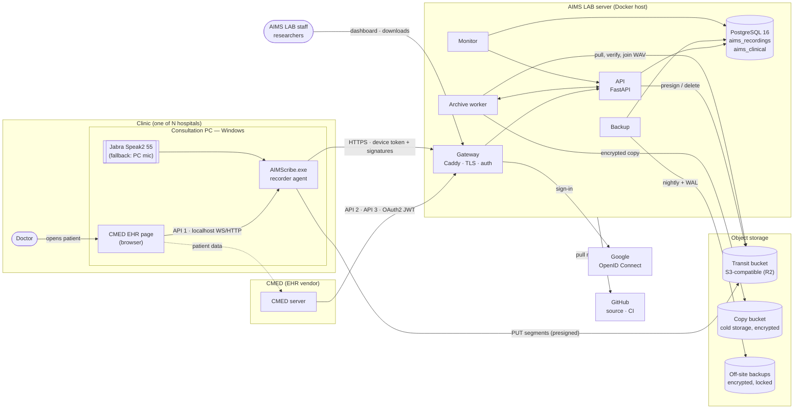

**Three identities, three channels.**

| Channel | Caller → callee | Authentication |
|---|---|---|
| API 1 (Channel A) | CMED page → recorder, same PC | Browser `Origin` must be in the centrally managed, signed trusted-origin list; loopback only; Windows-session check |
| Recorder ↔ server | `AIMScribe.exe` → AIMS LAB API | TPM-bound device key → device token; per-request signatures and nonces; TLS interception check |
| API 2/3 (Channel B) | CMED server → AIMS LAB API | HL7 SMART Backend Services: per-hospital key pair, signed JWT assertion → 5-minute bearer token |

---

## 5. Deployment architecture

### 5.1 Server topology

All server components run as Docker containers on one host, on three networks. Only the
gateway is reachable from the internet.

```mermaid
flowchart TB
    NET(("Internet"))

    subgraph edge["network: edge"]
        GW["gateway<br/>caddy:2.8<br/>:80 :443 (h1/h2/h3)"]
    end

    subgraph internal["network: internal (no internet)"]
        API["api<br/>FastAPI · uvicorn<br/>:6000"]
        PGB["pgbouncer<br/>transaction pooling"]
        PG[("postgres:16<br/>aims_recordings<br/>aims_clinical")]
        RD[("redis:7<br/>AOF · noeviction")]
        AW["archive-worker<br/>+ decrypt service"]
        WK["worker<br/>(transcription pipeline)"]
        MON["monitor"]
        BK["backup"]
        ADM["dbviewer<br/>adminer (portal-gated)"]
    end

    subgraph egress["network: egress (outbound only)"]
        E(("Object storage<br/>external APIs"))
    end

    NET --> GW
    GW -- "reverse_proxy" --> API
    GW -- "forward_auth /auth/check" --> API
    GW -- "/db (admins, researchers)" --> ADM
    API --> PGB --> PG
    API --> RD
    WK --> RD
    WK --> PGB
    AW -- "/api/v2/archive/* (worker key)" --> API
    API -. egress .-> E
    AW -. egress .-> E
    WK -. egress .-> E
    BK --> PG
    BK -. "off-site copies" .-> NET
    MON --> API
    MON --> PG
    MON -. "alerts (mail/webhook)" .-> NET
    ADM --> PG
```

| Container | Responsibility | Notes |
|---|---|---|
| `gateway` | TLS (ACME), HTTP/3, security headers, CSP, 2 MB body limit, portal auth via `forward_auth`, hard 404 for internal routes (`/api/v1`, `/docs`, `/api/v2/archive`, `/api/v2/maintenance`) | The only public listener |
| `api` | All HTTP APIs: device protocol, grants, Channel B (v4 JSON + FHIR R4), CMED OAuth, portal, dashboard, downloads, maintenance sweep | Stateless; scales horizontally behind PgBouncer |
| `pgbouncer` | Connection pooling to PostgreSQL | Transaction mode |
| `postgres` | Two databases (§10) | Tuned configs for 4 GB / 16 GB hosts; data guard installed |
| `redis` | Rate-limit counters, job queue for the transcription worker | `noeviction`, append-only |
| `archive-worker` | Pulls verified sessions from transit storage, joins WAVs, writes the archive tree, makes the encrypted cloud copy, performs erasures, serves decrypted downloads | The only holder of the copy-encryption key |
| `worker` | Optional transcription / NER pipeline (Azure OpenAI) | Isolated from the integrity layer |
| `backup` | Nightly encrypted dumps, WAL shipping, off-site upload with size check, labelled pre-deploy backups, scheduled restore drill | |
| `monitor` | Disk, DB, backups, archive queue, silent recorders, certificate expiry, CMED silence; alerts before a doctor would notice | |
| `dbviewer` | Adminer behind portal sign-in, per-person read-only DB logins | |

### 5.2 Storage tiers

| Tier | Holds | Lifetime | Who can do what |
|---|---|---|---|
| **Doctor PC spool** | Sealed segments, AES-256-GCM, key wrapped by DPAPI | Until a purge receipt arrives (or 7 days for unconfirmed) | Recorder only |
| **Transit bucket** (S3-compatible, Cloudflare R2) | Segments on their way to the archive | Until archived and copied | PCs: presigned PUT only. API: presign/delete. Cannot reach the copy bucket |
| **Archive** (server disk) | One WAV per consultation part, sorted tree, SHA-256 | `AIMS_ARCHIVE_LOCAL_RETENTION_DAYS` after a proven copy | Archive worker |
| **Copy bucket** (cold storage, second provider) | Encrypted merged WAV + clinical JSON | Long-term research copy | Write/read only, never delete |
| **Off-site backups** | Encrypted DB dumps and WAL | `AIMS_OFFSITE_KEEP_DAYS`, bucket lock | Backup container |

---

## 6. Component architecture

### 6.1 Recorder (`AIMScribe.exe`)

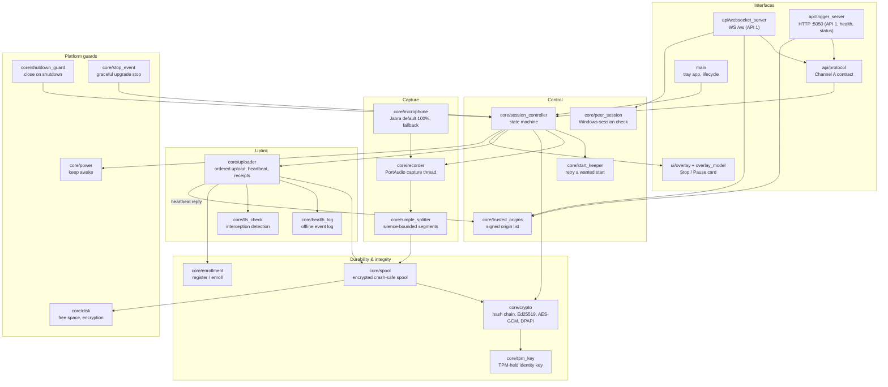

Key behaviours:

* **Capture thread isolation.** The PortAudio thread only reads and enqueues; hashing,
  loudness and file writes happen elsewhere, so the capture never glitches under load.
* **Microphone policy.** On start the Jabra speakerphone is made the Windows default
  (IPolicyConfig), unmuted, set to 100 %. Unplugged → recording continues on the PC
  microphone; replugged → it switches back mid-recording (checked every 5 s).
* **Recording end rules** (only these end a recording): a new `visit_id` arrives in API 1
  (previous one closes immediately, reason `superseded_by_new_patient`); the doctor
  presses Stop; two minutes after the server tells the PC that API 3 arrived (extended
  while speech continues); Windows shutdown / sign-out (closed cleanly by the guard).
* **Offline first start.** A brand-new PC with no internet at its first patient keeps the
  start and retries until it can register; a genuine refusal stops immediately.

### 6.2 Server API (`backend/src`)

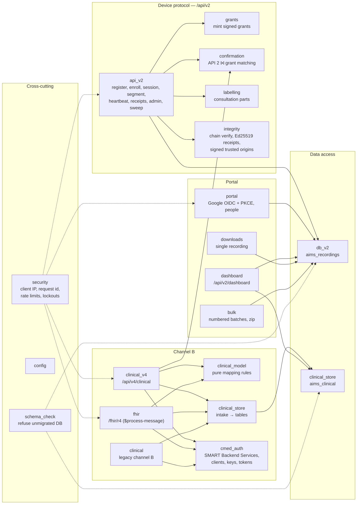

| Module | Responsibility |
|---|---|
| `main_fastapi` | App assembly, storage clients, router mounting, lifespan |
| `api_v2` | Device protocol, archive handshake, admin endpoints, maintenance sweep (device trust, alerts, expiries) |
| `grants` | Validates API 1 fields against the register; mints short-lived single-use grants |
| `confirmation` | Pairs a recording's grant with CMED's API 2 on the same five fields → `confirmed` |
| `labelling` | Splits a session into consultation parts when the doctor switches profiles |
| `integrity` | Mirror of the recorder's `core/crypto`: canonical JSON, chain verification, Ed25519 signing with domain separation |
| `cmed_auth` | Per-hospital CMED clients, JWK registration (`kid` = RFC 7638 thumbprint), assertion replay protection (`jti`), 5-minute tokens, CIDR pinning |
| `clinical_v4` | API 2/API 3 in plain JSON keyed by `visit_id`; never rejects for missing optional data (nulls kept) |
| `fhir` | The same messages as HL7 FHIR R4 message Bundles; SMART discovery |
| `clinical_model` / `clinical_store` | Store-then-load: raw message kept in `intake_records`/`visit_messages`, then mapped into relational tables; failures quarantined, never lost |
| `portal`, `dashboard`, `downloads`, `bulk` | Staff/researcher access: sign-in, operational dashboard, decrypt-on-demand downloads, rate-limited batch export |

### 6.3 Archive worker (`backend/archive_worker`)

| Module | Responsibility |
|---|---|
| `worker` | Poll `/api/v2/archive/pending`, download verified segments, archive, report `/archive/complete` so the server can issue purge receipts |
| `archive` | Path-safe archive tree, WAV joining, verification |
| `catalogue` | Local record of what the archive holds (survives a DB outage) |
| `cloudcopy` | Encrypt and upload the merged copy; verify; only then allow local deletion |
| `serve` | Decrypt one copy for a portal download (key never leaves this container) |
| `restore` | Rebuild the archive from the copy bucket (tested by the restore drill) |

---

## 7. How AIMScribe.exe communicates with the server

### 7.1 Transport and identity

* **Transport:** HTTPS to the public host, JSON bodies; segments go **directly** to the
  transit bucket by presigned `PUT`, never through the API.
* **TLS interception check:** the recorder detects antivirus/proxy re-signing and reports
  it rather than silently trusting an inspected channel.
* **Device identity:** an identity key generated **inside the TPM** (fallback: software
  Ed25519 wrapped with machine-scope DPAPI). The server stores only the public key.
* **Device token:** returned once at registration, stored hashed (`devices.token_sha256`).
* **Request signatures and nonces:** requests are signed by the device key; nonces are
  remembered (`device_nonces`) to reject replays.

### 7.2 Registration (first patient on a new PC)

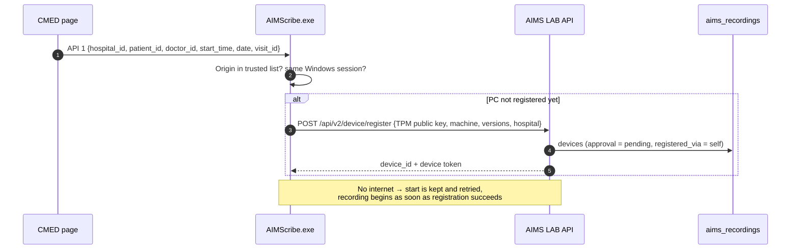

A self-registered PC is **pending** until CMED's server confirms two of its recordings
(then **approved**). It is **blocked** only on evidence (§12.3).

### 7.3 One consultation, end to end

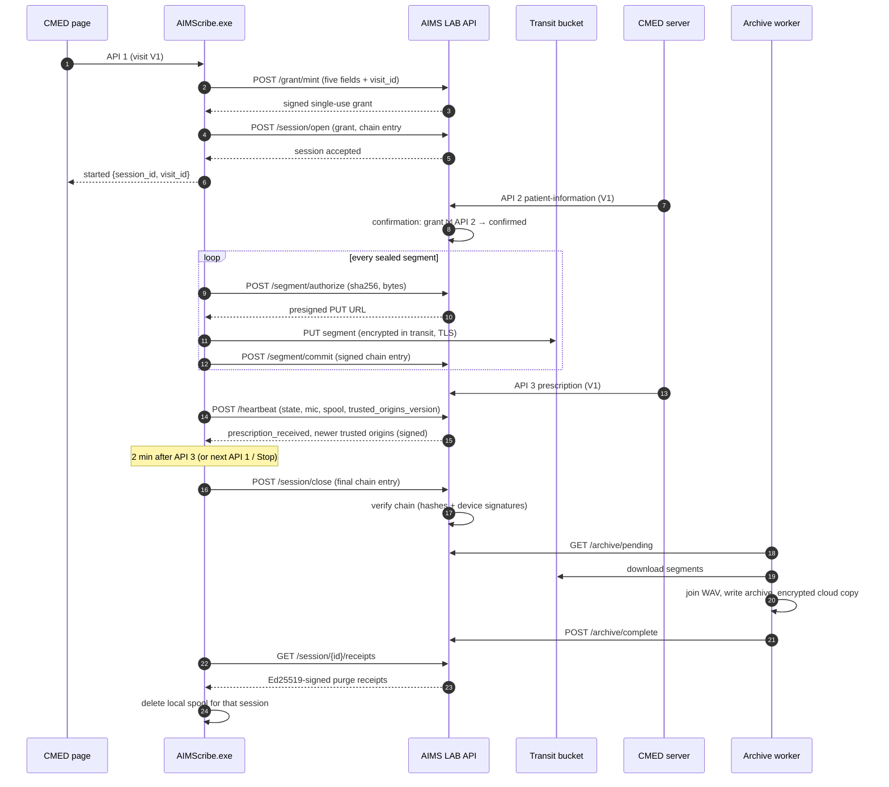

### 7.4 Endpoints used by the recorder (prefix `/api/v2`)

| Endpoint | Purpose |
|---|---|
| `POST /device/register` | Self-registration with the TPM public key (first start) |
| `POST /device/enroll` | Registration with a one-time enrolment token (managed installs) |
| `POST /grant/mint` | Exchange API 1 fields for a signed, single-use grant |
| `POST /session/open` · `/close` | Open/close a session with signed chain entries |
| `POST /session/pause` · `/resume` | Doctor pause/resume |
| `POST /session/marker` | A patient was opened / a prescription was built inside the session |
| `POST /session/reassign` | Move a stretch of audio to the right patient |
| `POST /session/refuse` | Patient declined: signed refusal, erased everywhere |
| `POST /segment/authorize` · `/commit` | Presign a segment upload; commit it to the chain |
| `POST /heartbeat` | Liveness, spool state, microphone, clock offset; reply carries prescription notices and the signed trusted-origin bundle |
| `POST /device/health` | Events logged while offline |
| `GET /session/{id}/receipts` | Signed purge receipts |
| `GET /session/{id}/confirmation` | Whether CMED has confirmed the recording |

### 7.5 Trusted-origin distribution

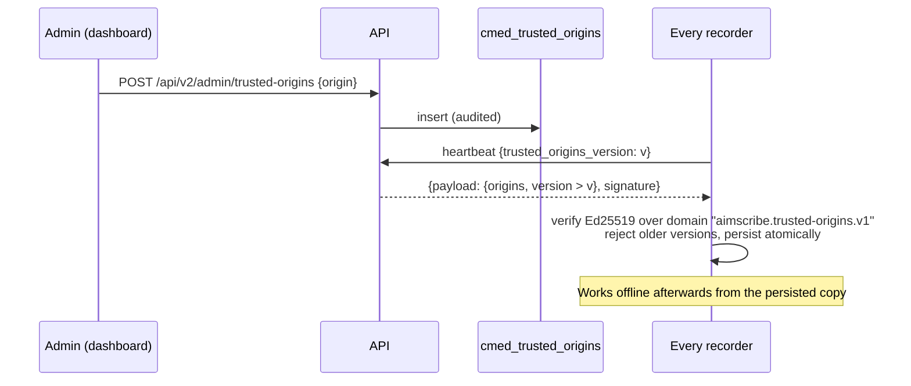

The signing domain differs from the purge-receipt domain (`aimscribe.receipt.v2`), so a
signature for one can never be replayed as the other.

---

## 8. CMED integration (Channel A and Channel B)

### 8.1 Channel B authentication (SMART Backend Services)

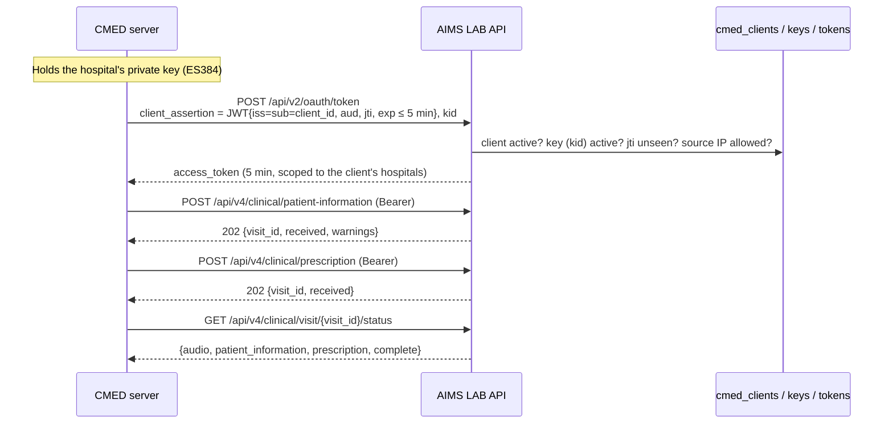

* **One client per hospital**: a leaked key affects one hospital only; keys rotate by
  adding a second `kid`, then revoking the first; clients expire yearly with an alert
  30 days before.
* **Onboarding** requires no shared secret: CMED generates the key pair, sends the public
  JWK and its `kid`; AIMS LAB registers it and confirms the `kid` by phone.

### 8.2 Message handling guarantees

| Guarantee | Mechanism |
|---|---|
| Nothing CMED sends is lost | Raw body stored first (`visit_messages`, `intake_records`); malformed input stored in `*_quarantine` |
| Idempotent | Body hashes (`body_sha256`, `content_sha256`); FHIR bundle ids (`fhir_messages`) |
| Optional data never rejects | Missing/empty fields become `NULL`, reported as `warnings` |
| Versioned prescriptions | `prescription_version`; latest wins, history kept |
| Silence detection | `hospitals.cmed_last_message_at`; alert `cmed_silent` when a clinic records but CMED is silent for 2 h |

---

## 9. Data flow diagrams

### 9.1 Level 0 — context

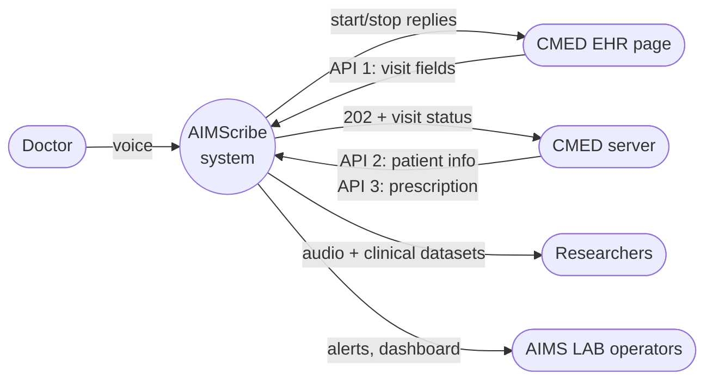

### 9.2 Level 1 — processes, stores and trust boundaries

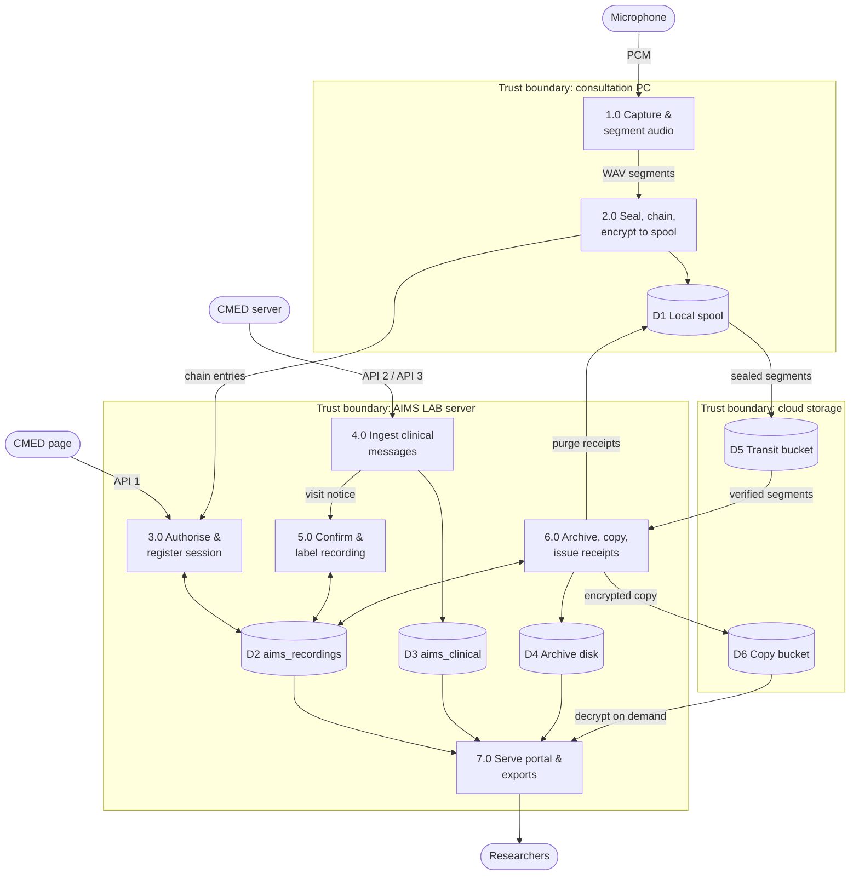

| Flow | Data | Protection |
|---|---|---|
| Microphone → spool | PCM audio | AES-256-GCM at rest, DPAPI-wrapped key |
| PC → transit bucket | Sealed segments | TLS, presigned single-object PUT, SHA-256 committed to the chain |
| PC → API | Chain entries, heartbeats | TLS, device token, device signatures, nonces |
| CMED → API | Patient info, prescriptions (PHI) | TLS, per-hospital OAuth2 token, IP pinning (optional) |
| Archive → copy bucket | Merged WAV, clinical JSON | Encrypted with a key held only by the archive worker; write-only credentials |
| Portal → researcher | Recordings, datasets | Google sign-in, allow-list, per-person DB login, rate limits, audit of every download |

---

## 10. Database (DBMS) architecture

### 10.1 Two databases, one cluster

| Database | Holds | Why separate |
|---|---|---|
| **`aims_recordings`** | Operational and integrity data: hospitals, devices, sessions, segments, chains, grants, receipts, CMED auth, portal, audit | High write rate, strict integrity rules, no clinical content beyond identifiers |
| **`aims_clinical`** | Everything CMED sends: raw messages, patients, visits, prescriptions, diagnoses, vitals | PHI isolated: different grants, different backup handling, separate researcher logins |

The two are joined **logically** (not by foreign key) through `visit_id`, `session_id`,
`file_stem` and `(hospital_id, patient_id)`.

### 10.2 Roles and privileges

| Role | Login | Rights |
|---|---|---|
| `aims_recordings` (owner) | No (migrations use `SET ROLE`) | Owns schema |
| `aims_api` | Yes (API, worker) | Rows only: no DDL, no TRUNCATE, no trigger changes; audit log is insert/select only |
| `aims_monitor` | Yes (monitor) | Read the views it needs |
| `aims_researchers` | No (group) | Read-only research views |
| per-person researcher logins | Yes | Members of `aims_researchers`, created from the portal |
| `aims_role_keeper` | No | Holds role memberships |

### 10.3 Data guard (enforced by PostgreSQL)

Installed by `migrate.sh` in its own superuser-owned schema, on both databases, on every
update:

1. No table, column, schema or materialized view may be dropped.
2. No table may be truncated.
3. No single statement may delete more than 5,000 rows.

A migration that genuinely must destroy data has to be listed in `DESTRUCTIVE_APPROVED`
(enforced by the deployment test gate) and set `aims.allow_destructive` for itself only.

### 10.4 Migrations and schema verification

* Numbered, forward-only SQL scripts: `backend/scripts/0NN_*.sql`, plus
  `backend/scripts/clinical/` for `aims_clinical`.
* Applied by `deploy/uiu/postgres/migrate.sh` **only after** a labelled backup of both
  databases (no backup → no deploy).
* Each applied script is recorded with its checksum; a changed script is reported.
* `schema_check.py` refuses to serve with a database missing a required migration
  (`AIMS_SCHEMA_STRICT`).

### 10.5 Append-only and tamper evidence

* `audit_log` and `chain_entries` are hash-linked (`prev_hash` → `entry_hash`); the API
  role cannot update or delete them.
* `purge_receipts` are Ed25519 signatures (64 bytes, checked by constraint).
* Segments carry SHA-256 (32 bytes, checked by constraint).

### 10.6 Backup and recovery

| Mechanism | Frequency | Target |
|---|---|---|
| Encrypted logical dump of both databases | Nightly + before every deploy that changes the schema | Local + off-site bucket (size-checked) |
| WAL shipping | Every `AIMS_WAL_SHIP_SECONDS` | Off-site |
| Restore drill | Every `AIMS_DRILL_EVERY_DAYS` | Scratch database, row counts compared; monitor alerts if overdue |
| Audio restore | On demand | `archive_worker/restore.py` from the copy bucket |

---

## 11. Entity–relationship diagrams

**Notation:** solid lines are enforced foreign keys; dashed lines are logical references
(same identifier, not FK-enforced — for example because rows outlive their parent or live
in the other database). Only the key and most significant columns are shown.

### 11.1 `aims_recordings` — identity, devices and CMED access

```mermaid
erDiagram
    hospitals ||--o{ devices : "hosts"
    hospitals ||--o{ doctors : "employs"
    hospitals ||--o{ enrollment_tokens : "issues"
    hospitals ||--o{ api_keys : "legacy keys"
    devices ||--o{ device_nonces : "replay guard"
    devices ||--o{ device_health_log : "reports"
    devices |o--o{ enrollment_tokens : "used by"
    devices ||--o{ grant_authorisations : "receives"
    devices ||--o{ integrity_alerts : "raises"
    devices ||--o{ audit_log : "acts in"
    cmed_clients ||--o{ cmed_client_keys : "has keys"
    cmed_clients ||--o{ cmed_access_tokens : "is issued"
    cmed_clients ||..o{ cmed_assertion_jti : "replay guard"
    cmed_clients ||..o{ fhir_messages : "sends"
    hospitals ||..o{ cmed_clients : "cmed_hospital_ids"

    hospitals {
        varchar hospital_id PK
        text name
        text timezone
        varchar cmed_hospital_id "CMED's code"
        timestamptz cmed_last_message_at
        timestamptz cmed_silence_alerted_at
        bool active
    }
    devices {
        uuid device_id PK
        varchar hospital_id FK
        bytea tpm_pubkey "32 B Ed25519 or 65 B P-256"
        bytea token_sha256
        varchar approval "pending|approved|rejected"
        varchar registered_via "token|self"
        timestamptz blocked_at
        timestamptz trust_judged_from
        timestamptz revoked_at
        text microphone
        bool microphone_is_clinic
        text app_version
        timestamptz last_heartbeat_at
    }
    doctors {
        text doctor_id PK
        text hospital_id PK
        text full_name
        bool active
    }
    enrollment_tokens {
        bytea token_sha256 PK
        varchar hospital_id FK
        uuid device_id FK
        timestamptz expires_at
        timestamptz used_at
    }
    api_keys {
        bytea key_sha256 PK
        varchar hospital_id FK
        text scope
        timestamptz revoked_at
    }
    device_nonces {
        uuid device_id PK
        varchar nonce PK
        timestamptz seen_at
    }
    device_health_log {
        uuid device_id PK
        bigint seq PK
        varchar kind
        jsonb data
    }
    grant_authorisations {
        text jti PK
        uuid device_id FK
        varchar hospital_id
        varchar patient_id
        varchar doctor_id
        varchar visit_id
        varchar session_id
        timestamptz expires_at
    }
    integrity_alerts {
        bigint id PK
        uuid device_id FK
        varchar session_id
        text alert_type
        text severity
        timestamptz resolved_at
    }
    audit_log {
        bigint id PK
        uuid device_id FK
        text event_type
        jsonb detail
        bytea prev_hash
        bytea entry_hash
    }
    cmed_clients {
        varchar client_id PK
        varchar_array cmed_hospital_ids
        text_array allowed_cidrs
        timestamptz expires_at
        timestamptz revoked_at
        timestamptz last_used_at
    }
    cmed_client_keys {
        varchar client_id PK
        varchar kid PK "RFC 7638 thumbprint"
        varchar alg "ES384|ES256|RS384"
        jsonb public_jwk
        timestamptz revoked_at
    }
    cmed_access_tokens {
        bytea token_sha256 PK
        varchar client_id FK
        varchar kid
        timestamptz expires_at
    }
    cmed_assertion_jti {
        varchar client_id PK
        varchar jti PK
        timestamptz expires_at
    }
    fhir_messages {
        varchar client_id PK
        varchar bundle_id PK
        bytea body_sha256
    }
    cmed_trusted_origins {
        text origin PK
        text added_by
        timestamptz added_at
        timestamptz removed_at
    }
```

### 11.2 `aims_recordings` — sessions, integrity, archive and erasure

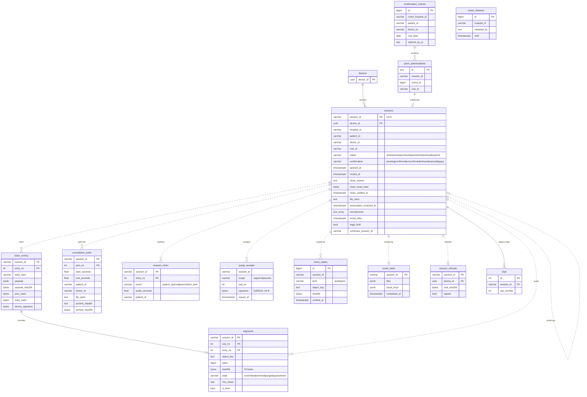

### 11.3 `aims_recordings` — portal

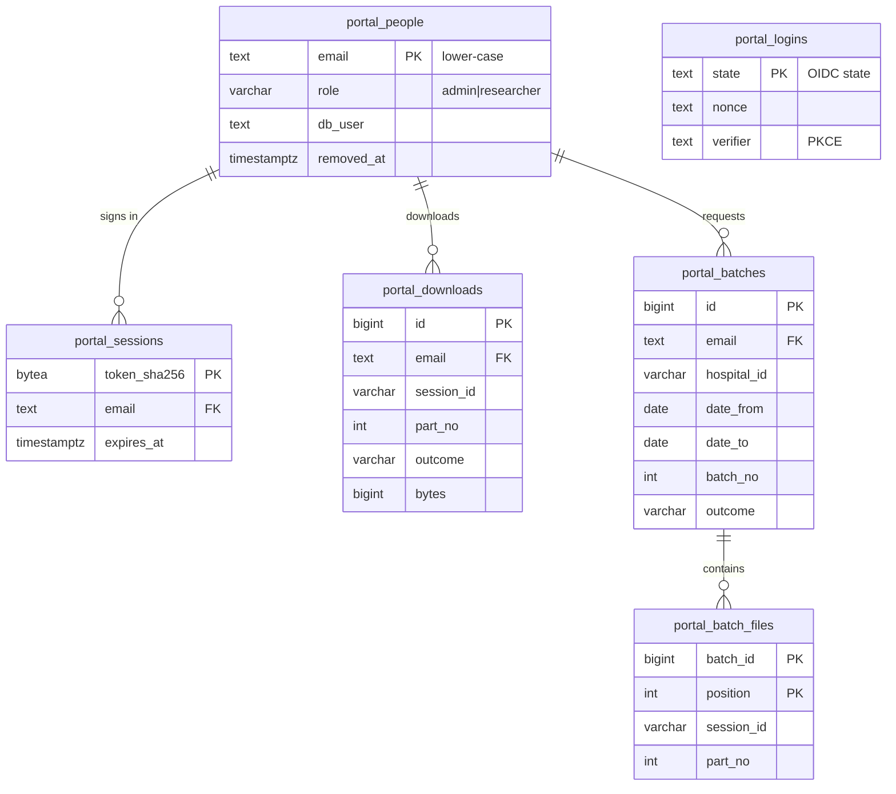

### 11.4 `aims_clinical`

Two models coexist: the **v4 visit model** (`patient`, `patient_visit`, keyed by CMED's
`visit_id`) used by interface v4, and the **encounter model** (`patients`, `encounters`,
`prescriptions` and child tables) used by the FHIR and legacy channel B paths.

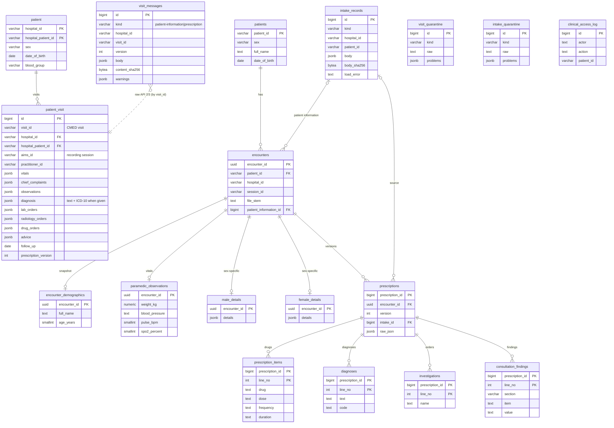

### 11.5 Cross-database join keys

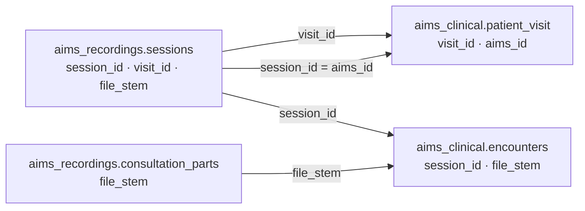

### 11.6 Table catalogue

<details>
<summary><b>aims_recordings</b> (34 tables, 11 views)</summary>

| Table | Purpose |
|---|---|
| `hospitals` | Clinics, their CMED code, CMED liveness |
| `doctors` | Doctors per clinic |
| `devices` | Recorder PCs: identity, approval/blocking, health, microphone |
| `enrollment_tokens` | One-time tokens for managed enrolment |
| `device_nonces` | Request replay protection |
| `device_health_log` | Events reported by PCs (including offline periods) |
| `grant_authorisations` | Minted recording grants (single use) |
| `confirmation_notices` | API 2 notices waiting to meet a grant |
| `sessions` | Recordings |
| `chain_entries` | Signed, hash-linked events per session |
| `segments` | Audio pieces and their lifecycle |
| `session_clicks` | Patient-opened / prescription-built markers |
| `consultation_parts` | Per-patient parts of a session and their archive files |
| `session_refusals` | Patient refusals |
| `purge_receipts` | Signed permissions for PCs to delete |
| `cloud_copies` | Proven copies in the copy bucket |
| `erase_tasks`, `erase_releases` | Erasure work and the circuit-breaker releases |
| `integrity_alerts` | Everything the system thinks is wrong |
| `audit_log` | Hash-linked, append-only audit trail |
| `cmed_clients`, `cmed_client_keys`, `cmed_access_tokens`, `cmed_assertion_jti` | CMED server identities |
| `cmed_trusted_origins` | EHR addresses recorders obey |
| `fhir_messages` | FHIR bundle de-duplication |
| `api_keys` | Legacy static keys (switched off in production) |
| `portal_people`, `portal_sessions`, `portal_logins` | Portal accounts and sign-in |
| `portal_downloads`, `portal_batches`, `portal_batch_files` | Audited exports |
| `clips` | v1 legacy |

Views: `v_devices`, `v_device_requests`, `v_doctors`, `v_doctor_register`, `v_doctor_activity`,
`v_audio_files`, `v_audio_daily`, `v_audio_problems`, `v_abnormal_closes`,
`v_session_pauses`, `patient_recordings`.
</details>

<details>
<summary><b>aims_clinical</b> (18 tables, 4 views)</summary>

| Table | Purpose |
|---|---|
| `visit_messages` / `visit_quarantine` | v4 raw API 2/API 3, and refused input |
| `patient`, `patient_visit` | v4 relational model keyed by `visit_id` |
| `intake_records` / `intake_quarantine` | Raw FHIR/legacy messages, and refused input |
| `patients`, `encounters`, `encounter_demographics` | Encounter model |
| `paramedic_observations`, `male_details`, `female_details` | Vitals and sex-specific details |
| `prescriptions`, `prescription_items`, `diagnoses`, `investigations`, `consultation_findings` | Prescription content, versioned |
| `clinical_access_log` | Who read which patient's record |

Views: `current_encounter`, `current_prescription`, `previous_prescription`,
`latest_prescriptions`.
</details>

---

## 12. Lifecycles and state machines

### 12.1 Recording (session)

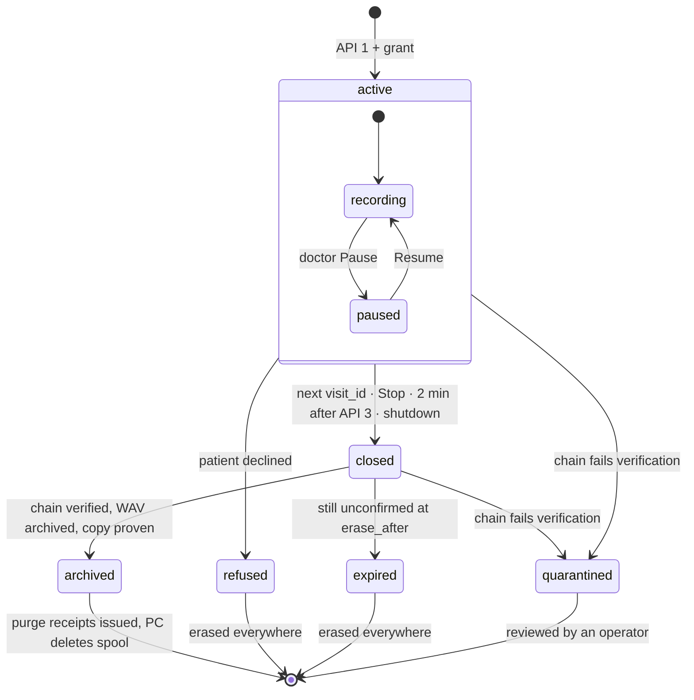

### 12.2 Confirmation (independent of the above)

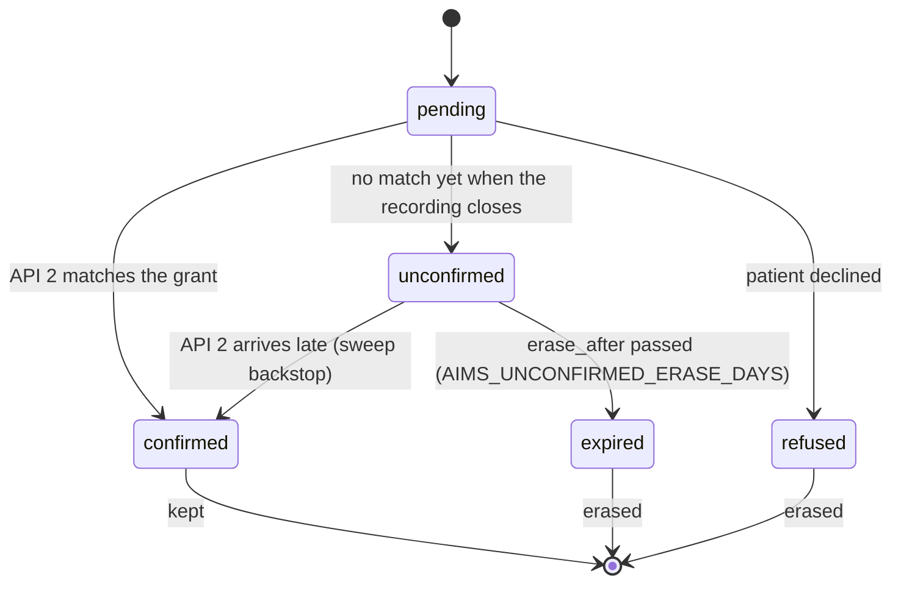

### 12.3 Device trust

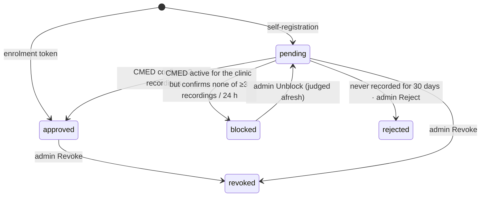

Blocking is **evidence-based**: it requires CMED to have been heard for that clinic after
the PC's recordings (with a grace period). An outage — no CMED messages at all — never
blocks a PC.

---

## 13. Security architecture

### 13.1 Key inventory

| Key | Algorithm | Where it lives | Purpose |
|---|---|---|---|
| Device identity | TPM-held key (fallback Ed25519 + DPAPI) | The PC's TPM | Signs chain entries and requests |
| Spool key | AES-256-GCM | PC, wrapped by DPAPI | Encrypts audio at rest |
| Grant key | Asymmetric signing | API (`AIMS_GRANT_PRIVATE_KEY`) | Signs recording grants |
| Receipt key | Ed25519 | API (`AIMS_RECEIPT_PRIVATE_KEY`) | Purge receipts (`aimscribe.receipt.v2`) and trusted origins (`aimscribe.trusted-origins.v1`) |
| Copy key | 256-bit symmetric | Archive worker only (`AIMS_COPY_KEY`), one sealed offline copy | Encrypts every cloud copy |
| CMED hospital keys | ES384 (ES256/RS384 accepted) | CMED's servers; AIMS LAB holds public JWKs only | Channel B client assertions |
| Backup key | Symmetric | Backup container | Encrypts dumps and WAL |
| Portal identity | Google OIDC + PKCE | Google | Staff sign-in; allow-list decides access |

### 13.2 Threats and controls

| Threat | Control |
|---|---|
| A malicious website on the doctor's PC drives the recorder | Origin allow-list (central, signed, versioned); `null`/absent origin refused; loopback bind; Windows-session check |
| A forged or replayed trusted-origin list | Ed25519 signature with its own domain; monotonic version; invalid entries (wildcards, paths) dropped |
| A copied recorder on another machine | TPM-bound key; device token hashed; request signatures and nonces |
| Unknown PCs filling storage | Pending quota per clinic, registration rate limit per address, evidence-based blocking, 30-day expiry |
| Audio tampering or deletion | Hash chain signed by the device, verified server-side before archive; SHA-256 per segment |
| PC deletes audio too early | Deletes only against server-signed purge receipts |
| A stolen CMED token | 5-minute lifetime, hospital scope, optional CIDR pinning, per-hospital keys, `jti` replay guard |
| A stolen CMED private key | Revoke the `kid`/client from the dashboard: effective immediately |
| Compromised API process | DB role without DDL/TRUNCATE/trigger rights; append-only audit; no access to the copy key or copy-bucket delete |
| Operator mistake / bad migration | Data guard; pre-deploy backup; CI gate; schema check |
| Mass erasure by a bug | Erase circuit breaker (`AIMS_ERASE_BREAKER_*`), manual release audited |
| TLS interception on clinic PCs | Recorder-side interception check and alert |
| Web attacks on the portal | Strict CSP, HSTS, `X-Frame-Options: DENY`, no-referrer, body limit, internal routes 404 at the edge |

---

## 14. Reliability, failure modes and operations

| Failure | Effect | Behaviour |
|---|---|---|
| Clinic internet down | None on recording | Spool holds audio; health events logged and sent later |
| New PC offline at first patient | Start delayed | Start kept and retried; records once registered |
| Jabra unplugged | None | Continues on the PC microphone; switches back when replugged; alert raised |
| AIMS LAB server down | None on recording | Uploads resume; monitor/uptime check alerts |
| CMED server silent | Recordings stay unconfirmed | `cmed_silent` alert after 2 h of clinic recordings; no PC is blocked |
| Transit bucket unreachable | Archive delayed | Archive-queue alert after 30 min |
| Database disk filling | Risk to writes | Floor alerts (`AIMS_DB_FLOOR_GB`, `AIMS_DISK_FLOOR_GB`) |
| Bad release | Not deployed | CI must pass; force-pushed history refused; health check after restart |
| Windows shutdown mid-consultation | None | Shutdown guard closes the recording cleanly |
| Installer upgrade mid-consultation | None | Graceful stop event; recording closed, not killed |

**Monitoring.** `monitor` evaluates disk, database, backups and drill age, archive queue,
silent recorders, certificate expiry and CMED silence during clinic hours, and alerts by
e-mail/webhook. A GitHub `uptime` workflow checks the public health endpoint externally.

---

## 15. Data retention and erasure

| Data | Retention |
|---|---|
| Unconfirmed recording | Erased after `AIMS_UNCONFIRMED_ERASE_DAYS` (default 7) |
| Refused recording | Erased immediately, everywhere (PC, transit, archive, copy) |
| PC spool | Until purge receipts |
| Transit segments | Until archived and the copy is proven |
| Archive WAV on server | `AIMS_ARCHIVE_LOCAL_RETENTION_DAYS` after a proven copy (0 on cloud hosts) |
| Cloud copy | Long-term research copy; `legal_hold` respected |
| Expired tokens, nonces, JTIs | Cleaned in small batches by the maintenance sweep |

Erasure is carried out by the archive worker from `erase_tasks`, reported back, and
audited. A circuit breaker stops erasing if an unusually large share would be erased at
once, until an operator releases it.

---

## 16. Build, test and release pipeline

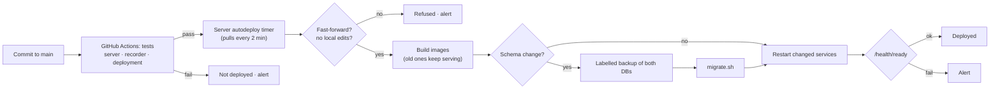

* **Server:** every suite runs in CI against a real PostgreSQL; the deployment gate also
  checks migrations against the data guard.
* **Recorder:** built with PyInstaller and packaged with Inno Setup (`recorder/BUILD.bat`);
  release builds are code-signed. One installer for every hospital; the server address is
  preset and CMED addresses arrive from the server.
* **History is append-only on `main`.** Autodeploy refuses a rewritten branch.

---

## 17. Configuration reference

Configuration is by environment (`deploy/uiu/.env`, from `.env.example`). Secrets are
never committed. Main groups:

| Group | Variables (selection) |
|---|---|
| Public endpoint | `AIMS_PUBLIC_HOST`, `AIMS_PUBLIC_BASE_URL`, `AIMS_TRUSTED_PROXIES` |
| Signing keys | `AIMS_GRANT_PRIVATE_KEY`, `AIMS_RECEIPT_PRIVATE_KEY`, `AIMS_COPY_KEY` |
| Devices | `AIMS_SELF_REGISTRATION`, `AIMS_PENDING_DEVICES_PER_CLINIC`, `AIMS_REGISTRATIONS_PER_ADDRESS_PER_DAY`, `AIMS_REQUIRE_DEVICE_SIGNATURES`, `AIMS_MIN_RECORDER_VERSION`, `AIMS_BLOCK_AFTER_RECORDINGS`, `AIMS_BLOCK_AFTER_HOURS`, `AIMS_BLOCK_GRACE_MINUTES`, `AIMS_PENDING_SILENT_DAYS` |
| CMED | `AIMS_CMED_LEGACY_KEYS` (off in production), `AIMS_CMED_SILENT_MINUTES`, `AIMS_FHIR_SYSTEM_*` |
| Storage | `MINIO_*` (transit), `AIMS_COPY_*` (copy), `AIMS_JSON_*`, `AIMS_OFFSITE_*` |
| Limits | `AIMS_RATE_PER_IP_PER_MINUTE`, `AIMS_TOKEN_RATE_PER_MINUTE`, `AIMS_AUTH_FAILURE_LIMIT`, `AIMS_MAX_SEGMENT_BYTES`, `AIMS_BULK_*`, `AIMS_DOWNLOAD_*` |
| Retention | `AIMS_UNCONFIRMED_ERASE_DAYS`, `AIMS_ERASE_BREAKER_*`, `AIMS_ARCHIVE_LOCAL_RETENTION_DAYS`, `AIMS_BACKUP_KEEP_DAYS` |
| Portal | `AIMS_GOOGLE_CLIENT_ID`, `AIMS_GOOGLE_CLIENT_SECRET`, `AIMS_PORTAL_OWNER_EMAIL` |
| Monitoring | `AIMS_ALERT_*`, `AIMS_*_FLOOR_GB`, `AIMS_CLINIC_HOURS`, `AIMS_DRILL_EVERY_DAYS` |

The recorder reads `.env` next to the executable (written by the installer):
`AIMS_BACKEND_URL`, optional extra `AIMS_ALLOWED_ORIGINS`, microphone and segmenting
settings.

---

## 18. Repository map

```text
AIMScribe_v3/
├── recorder/                 Windows recorder (AIMScribe.exe)
│   ├── main.py               tray application, lifecycle
│   ├── config.py             settings from .env
│   ├── api/                  Channel A: WebSocket + HTTP on 127.0.0.1:5050
│   ├── core/                 controller, capture, spool, crypto, TPM, upload
│   ├── ui/                   Stop / Pause overlay
│   ├── installer.iss         Inno Setup script
│   ├── BUILD.bat             build + sign + package
│   └── tests/
├── backend/
│   ├── src/                  FastAPI server (device protocol, Channel B, portal)
│   ├── archive_worker/       archive, cloud copy, erasure, decrypt service
│   ├── scripts/              numbered migrations, clinical/, roles/, guard/
│   ├── docker/               images
│   └── tests/
├── deploy/
│   ├── uiu/                  production compose, Caddy, Postgres, PgBouncer,
│   │                         backup, monitor, autodeploy, runbooks
│   └── local/                single-machine development stack
├── cmed-web/                 stand-in for CMED's page (integration testing)
├── openapi/                  API descriptions
├── tools/                    operator and test tools (CMED key tool, load test, …)
└── .github/workflows/        tests (CI gate), uptime
```

---

*This document is maintained with the code. A change to a protocol, schema or deployment
component should update the relevant section in the same commit.*
